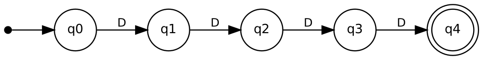
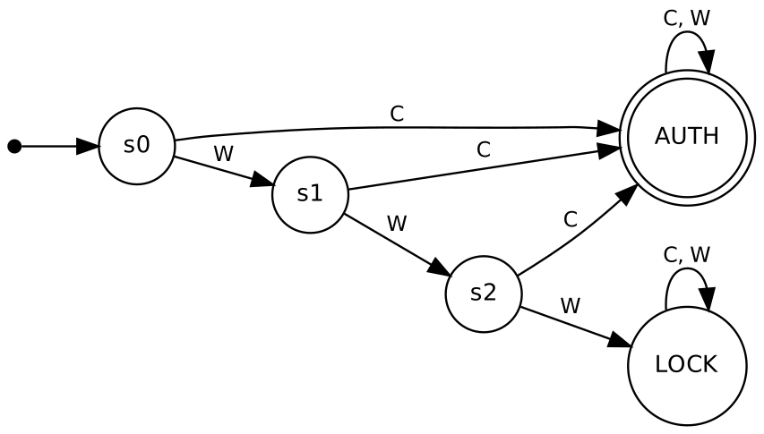
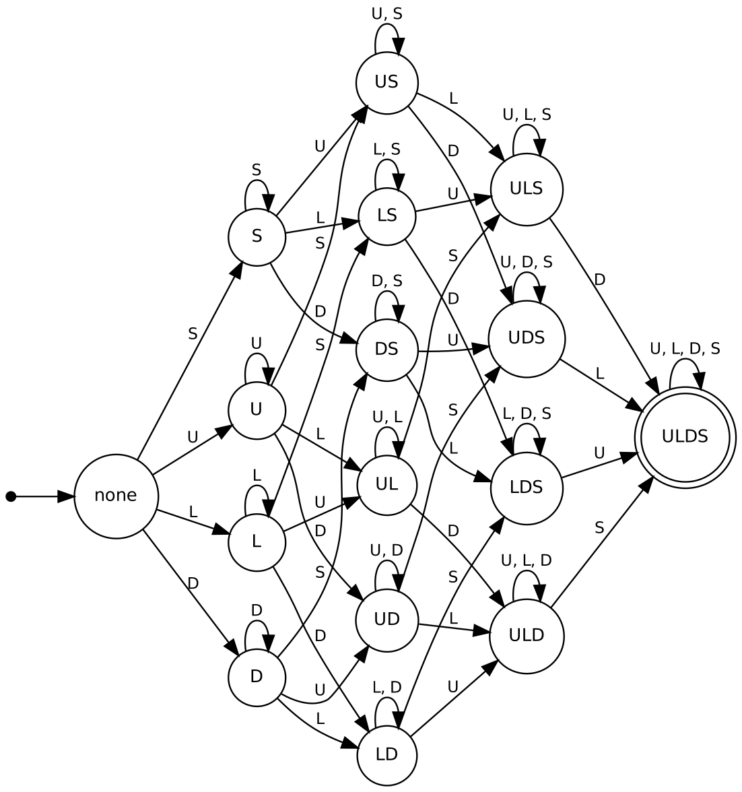
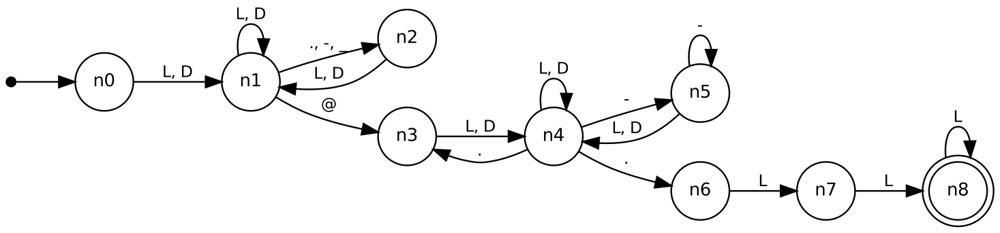
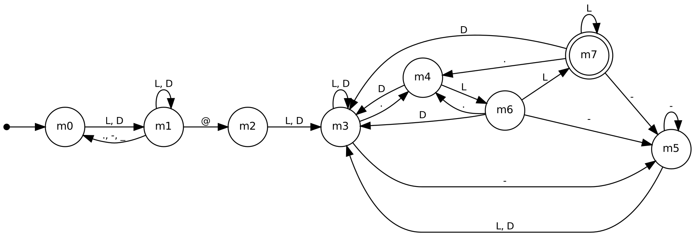

# Finite Automata for Real-Time Validation

**Course:** 21CSC301T Formal Language and Automata, CLA-2, Assessment Task 2
**Student:** K R Vaishak (RA2411026050018), B.Tech AIML 'A', III year
**Faculty:** Dr. C. Gunasundari, SRM IST Tiruchirappalli

This repo has DFAs/NFAs for three input-validation jobs you meet every day:

| # | Application | Automaton | Live states |
|---|---|---|---|
| 1 | ATM PIN verification | DFA for the PIN format + DFA for the 3-strikes card lock | 5 + 5 |
| 2 | Password policy | product of 5 small DFAs, then minimised | 196 |
| 3 | E-mail address format | hand-written NFA → subset construction → minimal DFA | 9 → 9 → 8 |

Each automaton runs on real strings. The test suite also checks every automaton
against an independently written rule or regex on thousands of generated
strings, so the diagrams are backed by evidence, not just drawn.

## Run it

```bash
pip install pytest                      # only needed for the tests
python -m fa_validators.cli             # every application, accept/reject table
python -m fa_validators.cli email vaishak@srm.c0m   # one string, full δ-trace
python -m fa_validators.cli --stats     # design comparison (state counts)
python -m fa_validators.cli --limits    # what each automaton cannot check
python -m pytest -q                     # 62 tests
python tools/make_diagrams.py           # rebuild diagrams + web demo (needs Graphviz)
```

To see the **browser demo**, open `docs/index.html`. Pick an application and type a
string. The page highlights the current state on the diagram and lists every
transition taken.

## 1. ATM PIN

* Σ = {D, O}, where D is a digit 0-9 and O is any other character.
* L = { w ∈ D* : |w| = 4 }



q0 to q4 count the digits read so far. Any O, or a fifth digit, sends the machine
to the trap state qD, which never accepts. The bank-style variant "4 or 6 digits"
(`pin46_dfa.png`) only needs two more states, with q4 and q6 both accepting.

**Session lock-out.** Over the event alphabet {C = correct PIN, W = wrong PIN} the
card is blocked after three consecutive W:



## 2. Password policy

Policy: length 8-16, at least one upper-case letter, one lower-case letter, one
digit and one special character from `!@#$%^&*()-_=+[]{};:,.?/`. No spaces.

* Σ = {U, L, D, S, O}
* L = L_U ∩ L_L ∩ L_D ∩ L_S ∩ L_len

Each condition is a tiny DFA: 2 states for "contains a U", 17 for the length.
Regular languages are closed under intersection, so the product construction
gives one DFA for the whole policy. The 16-state "which classes have I seen"
part looks like a hypercube:



| Design | States |
|---|---|
| 5 DFAs run side by side | 25 |
| Product DFA (reachable part) | 240 |
| Product after minimisation | 196 |

The single DFA is the formal answer. Running the five small DFAs in parallel is
the same machine in practice and much easier to maintain.

## 3. E-mail format

This is a practical subset of RFC 5322:

```
local  = alnum+ ( [._-] alnum+ )*
domain = label ( "." label )* "." tld      label = alnum+ ( "-"+ alnum+ )*
tld    = letter{2,}
```

The NFA is the natural way to write this. After each dot in the domain it
guesses whether that dot starts the top-level domain:



Subset construction gives 9 states. Minimisation merges {n0} and {n2}: just after
a `.`, `_` or `-` in the local part the machine is in exactly the same situation
as at the very start, because it needs an alphanumeric character. That leaves 8 states:



| state | NFA subset | meaning |
|---|---|---|
| m0 | {n0, n2} | start of a local-part word |
| m1 | {n1} | inside a local-part word |
| m2 | {n3} | just read `@` |
| m3 | {n4} | inside a domain label (not a TLD candidate) |
| m4 | {n3, n6} | just read a `.` in the domain |
| m5 | {n5} | inside a run of `-` |
| m6 | {n4, n7} | one letter after the last dot |
| m7 | {n4, n8} | ≥ 2 letters after the last dot: **accept** |

## Syntax vs. semantics

The FA answers "is this string *shaped* correctly?" It cannot answer:

* whether 4821 is *this card's* PIN (needs the bank's stored hash),
* whether `srmist.edu.in` has a mail server (needs DNS),
* whether a password appears in a leaked-password list (finite, so regular in
  theory, but a hash-set lookup is the sane implementation),
* rules that need unbounded counting, e.g. "as many letters as digits". These
  are not regular, as the pumping lemma shows.

The full list is printed by `python -m fa_validators.cli --limits`.

## Layout

```
fa_validators/automata.py    DFA, NFA, product, complement, minimisation, DOT export
fa_validators/validators.py  the three applications, test strings, limitations
fa_validators/cli.py         terminal demo
tests/                       pytest suite (listed examples + exhaustive cross-checks)
tools/make_diagrams.py       builds docs/diagrams/* and docs/index.html
docs/                        diagrams and the browser demo
```
